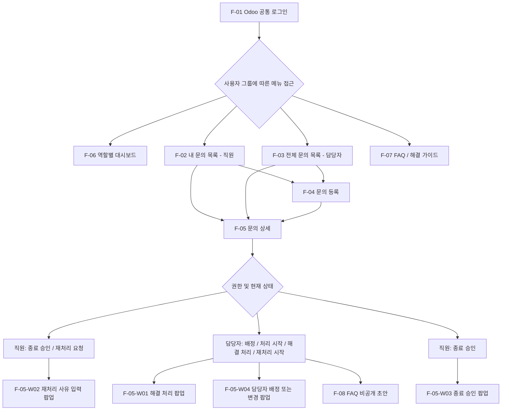

# IT-Helpdesk 화면 설계서 (1차)

> 기준: `docs/requirements.md`, `docs/erd.drawio`  
> 작성 기준: 2026-10-23 Day 7 FR-20·21 및 실시간 FAQ 추천 구현과 대조. 현재 구현과 향후 보완 사항을 구분하며 Odoo 19 UI 및 접근 제어는 실제 테스트로 검증.

## 1. 화면 구성과 이동

메뉴 접근 범위는 역할에 따라 다르며, 화면 ID는 화면 설계용 분류다. F-05는 두 역할이 공유하는 Odoo Form View이고 상태와 권한에 따라 버튼을 다르게 표시한다. 실제 로그인 후 자동 진입 경로는 구현에서 검증한다.

## 2. F-06 역할별 대시보드

최상위 `IT Helpdesk → 대시보드` 메뉴는 일반 직원과 IT 담당자 모두 접근한다. 담당자 그룹은 직원 그룹을 포함하지만 서버가 담당자 역할을 우선 판별해 담당자용 화면을 제공한다.

| 구분 | 일반 직원 | IT 담당자 |
|---|---|---|
| 기본 범위 | 본인이 요청자인 활성 문의 | 전체 활성 문의 |
| KPI | 내 전체, 처리 중, 해결 대기, 종료 완료 | 전체, 미배정, 진행 중, 긴급 미해결 |
| 분포 | 7개 상태 | 7개 상태, 4개 긴급도 |
| 목록 | 최근 문의 5건 | 최근 문의 5건, 긴급 미해결 5건 |
| 바로가기 | 새 문의 등록, 내 문의 목록 | 전체 문의 목록, 미배정 문의 |

- KPI와 분포 항목을 누르면 기존 역할별 문의 목록 액션에 해당 조건을 추가해 이동한다.
- 최근 문의를 누르면 기존 Ticket Form으로 이동하며 ACL과 Record Rule을 그대로 적용한다.
- 로딩, 오류, 0건 상태를 각각 표시한다. 화면 재진입 또는 새로고침 버튼으로 최신 데이터를 다시 집계한다.
- 긴급도 배지만 낮음(회색), 보통(파랑), 높음(주황), 긴급(빨강) 색상을 사용하며 일반 정보는 긴급도 색상을 사용하지 않는다.

## 3. F-01 공통 로그인

- 전체 사용자에게 Odoo 기본 로그인(로그인 ID/비밀번호)을 제공한다.
- 로그인 성공 후 그룹과 접근 권한에 따라 메뉴·접근 가능한 데이터를 구분한다.
- 로그인 실패 및 세션 만료는 Odoo 표준 인증 흐름을 활용한다.
- 임의의 별도 로그인·비밀번호 DB 테이블을 구축하지 않는다.

## 3.1 F-07 FAQ / 해결 가이드 및 FAQ 관리

| 구분 | 일반 직원 | IT 담당자 |
|---|---|---|
| 공개 FAQ | 활성·공개 FAQ 목록·상세·검색 | 동일 |
| 관리 화면 | 접근 불가 | 전체 FAQ 작성·수정·공개·비공개·보관·복원 |
| 원본 문의 | 필드와 RPC 읽기 차단 | 읽기 권한이 있는 원본 문의 연결 확인 |
| 삭제 | 불가 | 실제 삭제 불가, 보관 사용 |

- 공개 FAQ 화면은 제목·유형·검색 키워드·마지막 수정일과 일반 텍스트 해결 방법만 표시한다.
- 관리 화면은 저장과 공개를 분리한다. 신규 FAQ는 비공개이며 헤더 버튼으로 공개 상태를 변경한다.
- 공개·비공개·보관 여부는 메뉴 도메인뿐 아니라 ACL, Record Rule과 서버 메서드에서 검증한다.

## 4. F-02 내 문의 목록 — 일반 직원

| 항목 | 확정 내용 |
|---|---|
| 조회 범위 | 로그인한 본인의 문의만; Record Rule로 서버 접근 제한 |
| 컬럼 | 문의 번호, 제목, 유형, 긴급도, 상태, 담당자, 등록일 |
| 검색 | 번호·제목·유형·상태·긴급도·요청자·담당자 검색 항목(공통 Search View, 결과는 본인 문의로 제한) |
| 필터 | 7개 상태·4개 긴급도·미배정·내 담당 필터; 유형·상태·긴급도·담당자 그룹화. 직원에게 불필요한 담당자 필터도 공통 노출되어 사용성 개선 예정 |
| 정렬 | `create_date DESC` 기본 최신 등록순. 별도 긴급도순 선택 정렬 UI는 미확인 |
| 페이징 | Odoo 기본 페이징 |
| 버튼 | 상단 우측 신규 문의 등록(Odoo 기본 New 버튼 표기는 실제 UI에 맞춤) |
| 이동 | 목록 행 클릭 → F-05, 새 문의 등록 → F-04 |
| 예외 | 본인 문의가 없는 경우 신규 등록 안내, 검색 결과 없는 경우 필터 재설정 가능 |

## 5. F-03 전체 문의 목록 — 담당자

| 항목 | 확정 내용 |
|---|---|
| 조회 범위 | 전체 문의 |
| 컬럼 | F-02의 7개 + 요청자 = 8개 |
| 검색 | 번호·제목·유형·상태·긴급도·요청자·담당자 |
| 필터 | 7개 상태·4개 긴급도·미배정·내 담당 필터, 유형·상태·긴급도·담당자 그룹화 |
| 정렬 | `priority_order DESC, create_date ASC` 기본 정렬(긴급→높음→보통→낮음, 동일 긴급도는 오래된 문의 우선) |
| 메뉴 | 전체 문의·미배정 문의·보관된 문의 및 담당자 전용 `설정 → 문의 유형`; 유형 목록·상세에서 유효한 기본 담당자 설정 |
| 버튼 | 새 문의 등록 → F-04 |
| 이동 | 행 클릭 → F-05, 배정/처리/해결은 F-05에서 수행 |
| 페이징·예외 | Odoo 기본 페이징 및 결과 없음 안내 |

## 6. F-04 문의 등록 — 직원·담당자 공통

### 6.1 입력 화면

| 순서 | 항목 | 필수 여부 | 검증 기준 |
|---|---|---|---|
| 1 | 문의 유형 | 필수 | 관리자가 등록한 활성 유형만 선택. 유형 레코드 신규 생성·직접 편집·열기는 Ticket Form에서 차단 |
| 2 | 제목 | 필수 | 공백 제외 5~100자 |
| 3 | 내용 | 필수 | 공백 제외 10~5,000자 |
| 4 | 긴급도 | 필수 | 낮음·보통·높음·긴급 |
| 5 | 발생 위치/부서 | 필수 | 공백 제외 2~100자 |
| 6 | 연락처 | 선택 | 숫자 9~11자리(공백·하이픈 허용), 저장 시 자동 하이픈 형식 통일 |
| 7 | 첨부파일 | 선택 | JPG/JPEG/PNG/PDF/DOCX/XLSX/TXT, 문의당 최대 5개·파일당 최대 10MiB 서버 제한 |

시스템 자동 필드: 문의 번호 `HD-00001`(순차 생성), 요청자(로그인한 본인), 등록일(Odoo 기본 생성 일시). 유형에 유효한 기본 IT 담당자가 있으면 담당자를 자동 지정하고 상태는 `assigned`로 시작한다. 기본 담당자가 없거나 무효하면 `received`·미배정으로 접수한다.

### 6.1.1 실시간 FAQ 추천

- 제목 필드는 Odoo 19 기본 Char Field를 상속한 전용 위젯을 사용한다. 신규 문의에서만 제목 2자 이상 입력 후 400ms 디바운스로 검색한다.
- 제목·유형 변경 시 추천을 갱신하고, 요청 순번이 지난 응답은 표시하지 않는다. 화면 이탈 시 타이머와 후속 상태 갱신을 중단한다.
- 최대 3건의 FAQ 제목·유형·해결 방법 미리보기를 표시한다. 상세 보기는 읽기 전용 모달이므로 작성 중인 제목·내용·유형·긴급도·위치·연락처·첨부 상태를 유지한다.
- 검색 실패와 결과 없음은 별도 안내만 표시하고 기존 문의 저장을 막지 않는다.

### 6.2 긴급도 판단 기준

| 단계 | 기준 |
|---|---|
| 낮음 | 업무에 거의 영향 없음 |
| 보통 | 불편하나 대체 방법으로 업무 가능 |
| 높음 | 주요 업무 중단 또는 대체 방법 없음 |
| 긴급 | 다수 직원 업무 중단 또는 핵심 업무 전체의 심각한 장애 |

최초 긴급도는 등록자가 선택하고, 직원은 등록 후 변경할 수 없다. 담당자는 종료 전 변경할 수 있으며 변경 전후 값·변경자는 History에 기록한다(코드 구현). 등록 화면에서 각 단계 판단 기준의 별도 안내는 미구현이다.

### 6.3 저장·취소·검증

- Odoo Form View 기본 저장·취소를 우선 활용한다.
- 저장 성공: 문의 생성 및 번호 발급, 해당 문의 상세를 확인할 수 있도록 한다(정확한 전환은 실제 Odoo 동작 검증).
- 잘못된 입력: 서버에서 저장 차단 및 오류 안내. 인증 실패/세션 만료는 Odoo 표준 흐름을 따른다.
- 첨부는 `mail.thread`/`ir.attachment`를 활용하며 서버에서 형식·용량·개수·권한·종료 상태·임시 파일 연결을 검사한다. 정상 문의 TXT 업로드 및 종료 문의 차단을 UI에서 확인했다.
- 담당자가 문의를 등록해도 요청자는 등록한 담당자 본인. 다른 직원을 대신해 등록하는 기능은 1차 범위에서 제외한다. Day 4부터 `create()`에서 직원·담당자 모두 임의 요청자 지정이 차단되며 자동 테스트가 있다.

## 7. F-05 공통 문의 상세

### 7.1 공통 표시 정보

- 식별: 번호, 제목, 현재 상태
- 접수: 요청자, 등록일
- 장애: 유형, 긴급도, 발생 위치, 연락처, 상세 내용
- 처리: 담당자, 해결 방식(`resolution_method`), 해결 결과(`resolution`), 해결/종료 시각
- 협업: 댓글, 첨부파일(Chatter)
- 감사: 상태·담당자·긴급도·재처리·해결 결과 변경 이력(History 별도 조회 영역)

### 7.2 직원의 상태별 작업

| 상태 | 허용 작업 |
|---|---|
| 접수·미배정 | 본인 문의의 원본 5개 필드(제목·내용·유형·위치/부서·연락처) 수정·아카이브, 조회, 댓글·첨부 |
| 배정 / 처리 중 / 재처리 요청 / 재처리 중 | 본인 문의 조회·이력 확인, 댓글·첨부(서버 접근 검사 적용) |
| 해결 | 해결 결과 확인 후 종료 승인 또는 사유 있는 재처리 요청, 댓글·첨부(서버 접근 검사 적용) |
| 종료 | 일반 수정과 새 댓글·첨부 추가 불가(서버 차단); 담당자 별도 보관·복원 가능. 기존 댓글·첨부 수정/삭제는 추가 검토 |

- 종료 승인: 간단한 확인 팝업을 거쳐 `resolved → closed`; `closed_date`와 History 기록.
- F-05-W02 재처리 요청 팝업: 사유 필수, `resolved → reopen_requested`; `reopen_count` 증가, History에 사유 및 변경자·시각 보존. 담당자가 재처리 시작 시 `reopen_requested → reopened_in_progress`로 변경하고 재해결하면 `resolved`로 돌아간다.
- 재처리 시 기존 `resolution`, `resolution_method`, `resolved_date`는 History에 보존하고 Ticket의 현재 세 필드는 초기화한다. 기존 담당자는 유지하고, 다시 해결할 때 신규 해결 결과·방식·시각을 저장한다.
- F-05-W03 종료 승인 확인 팝업은 `resolved → closed` 전환만 수행하며 종료 일시와 변경 이력을 기록한다. 직원은 최초 등록 후 긴급도를 바꿀 수 없다.

### 7.3 담당자의 상태별 작업

| 상태 | 허용 작업 및 전이 |
|---|---|
| 접수 | 담당자 지정 → 배정 |
| 배정 | 처리 시작 → 처리 중 |
| 처리 중 | F-05-W01 해결 처리 → 해결 |
| 재처리 요청 | 재처리 시작 → 재처리 중 |
| 재처리 중 | F-05-W01 해결 처리 → 해결 |
| 해결 | 요청자 확인 대기; 재배정 시에도 상태 유지. 해결 내용 재작성·종료 전환은 허용된 별도 업무 절차만 가능 |
| 종료 | 일반 수정·상태 변경·댓글·첨부 불가; 담당자(관리자)의 별도 보관·복원 관리 기능만 가능 |

- 신규 문의 자동 배정: 유형에 설정된 기본 담당자가 활성 내부 IT 담당자이면 생성과 동시에 담당자를 지정하고 `assigned`로 저장하며 자동 배정 History를 남긴다. 기본 담당자 미설정·무효 시에는 `received`·미배정으로 접수하고 성공 History를 만들지 않는다. 기존 문의와 유형 변경에는 소급 적용하지 않는다.
- F-05-W04 담당자 배정·변경 팝업: IT 담당자 그룹에 속한 활성 내부 사용자만 선택할 수 있다. 최초 배정 시 접수→배정, 재배정은 상태를 유지하며 이전·새 담당자와 변경자를 이력에 남긴다. 자동 배정된 문의도 동일하게 수동 재배정할 수 있다.
- `resolved`·`closed` 문의에서 담당자에게 `FAQ 초안 생성` 버튼을 제공한다. 제목·유형·해결 내용만 활성 비공개 FAQ로 복사하고 원본 문의는 변경하지 않는다. 다른 상태와 직원의 서버 직접 호출은 차단한다.
- Ticket의 유형(`category_id`)은 등록된 활성 유형만 선택 가능하며, 유형 레코드를 Ticket 화면에서 직접 생성·편집·열 수 없다. 직원은 접수·미배정 상태인 본인 문의의 유형 선택을 변경할 수 있고, 담당자는 저장 이후 변경할 수 없다. 유형 자체 관리(이름·코드·활성 상태)는 담당자 전용 `설정 → 문의 유형` 메뉴에서 수행한다.
- 담당자는 **등록된 문의의 원본 5개 필드를 수정할 수 없다.** 화면에서 읽기 전용이며 서버 `write()`의 허용 목록도 `priority`, `active` 두 항목으로 제한한다(종료 상태는 `active`만 허용). 신규 문의 등록 중에는 원본 항목을 입력할 수 있다.
- 긴급도는 담당자가 수정할 수 있고 변경 이력을 남긴다.
- F-05-W01 해결 처리 팝업: **해결 방식** `onsite`(현장 방문) / `remote`(원격·안내) 중 하나와 **해결 결과**를 필수 입력. 검증 통과 시 두 값 저장, `in_progress` 또는 `reopened_in_progress → resolved`, 해결 시각 및 History 기록을 하나의 작업으로 처리한다.
- 해결 방식은 처리 상태와 별개이다. 별도의 현장 처리/원격 처리 상태는 만들지 않는다.
- 일반 직원의 아카이브는 본인 문의가 `접수`이면서 미배정일 때만 허용한다. 담당자(관리자)는 별도 관리 작업으로 문의 아카이브·복원을 수행할 수 있으며 종료 문의도 대상에 포함된다. 실제 레코드 삭제는 허용하지 않는다.

### 7.4 미응답과 자동 종료

- 1차: 직원이 해결 결과에 응답하지 않으면 `resolved` 유지; 자동 종료 없음.
- 향후 검토: 사전 안내 후 정책상 자동 종료를 검토할 수 있으나, **요청자의 승인으로 기록해서는 안 된다.** 3+2영업일은 확정 정책이 아니라 논의했던 예시이다.

## 8. 공통 접근 권한 및 예외

| 사례 | 기대 동작 |
|---|---|
| 타인의 문의에 직원이 접근 | ACL/Record Rule/관련 첨부 접근에서 거부 |
| 권한 없이 원본 문의·담당자·긴급도·상태 변경 | 서버 차단 (`write()` 허용 목록, 전용 업무 메서드) |
| 직원이 신규 문의에 담당자·초기 상태 직접 지정 | 서버 차단 후 유형 기준 서버 자동 배정만 허용 |
| 기본 담당자가 비활성·외부 사용자·권한 제거 상태 | 문의는 `received`·미배정으로 정상 접수, 자동 배정 History 미생성 |
| 권한 없는 사용자의 기본 담당자 변경 | 카테고리 ACL로 차단; 유효하지 않은 담당자는 서버 검증으로 차단 |
| 직원의 비공개·보관 FAQ ID/RPC 접근 | FAQ Record Rule로 차단 |
| 직원의 FAQ 원본 문의 필드 직접 읽기 | 담당자 그룹 필드 제한으로 차단 |
| 추천 검색 요청 조작 | 서버가 항상 공개·활성 FAQ 도메인을 강제하고 공개용 4개 값만 반환 |
| 미해결 문의 또는 직원의 FAQ 초안 요청 | 서버 역할·상태 검증으로 차단 |
| 직원이 타인의 History 직접 조회 | History Record Rule로 제한 구현 |
| 담당자가 타인 명의로 신규 등록 요청 | 서버 `create()`에서 차단 구현 및 자동 테스트 |
| 해결 방식 또는 결과 누락 | 해결 불가, 오류 안내 |
| 재처리 사유 누락 | 재처리 불가, 오류 안내 |
| 허용되지 않는 상태 전이 | 서버 차단 |
| 종료된 문의 수정·댓글·첨부 | 서버 차단 |
| 보관된 문의 | 기본 목록 제외; 권한에 맞는 접근만 허용 |
| 없는 문의·동시 변경 | 명확한 오류/재조회 안내, 잘못된 상태 덮어쓰기 방지 |

UI 버튼 숨김만으로 보안을 구현하지 않는다. `ir.model.access`, `ir.rule`과 Python ORM 서버 제약을 함께 사용하고, Chatter·첨부 권한도 테스트한다.

## 9. Day 4 구현·테스트 확인 및 후속 점검

- Odoo 19의 Form 저장/취소 및 저장 후 진입 위치
- History Record Rule 구현 및 타인 문의 조회 제한; 추가 직접 API 접근 점검 가능
- 직원·담당자의 타인 요청자 지정 서버 차단 및 자동 테스트
- 종료 상태의 새 Chatter 댓글·첨부 차단 구현 및 UI 점검
- 첨부 형식·5개·10MiB 제한 구현; UTF-8/BOM/CRLF TXT 자동 테스트 및 TXT UI 확인
- 해결 결과/해결 방식/해결 시각 기록과 History 정합성, 재처리 후 과거 해결 정보 보존 및 현재 필드 초기화
- 긴급도 값 변경 시 저장형 `priority_order` 자동 갱신 및 F-03 기본 정렬(`priority_order DESC, create_date ASC`) 검증
- 종료된 문의의 일반 수정 차단과 담당자(관리자)의 별도 아카이브·복원 권한 검증
- 직원·담당자 각각의 메뉴/액션/목록·상세 접근 테스트
- 담당자 보관된 문의 목록·복원 UI 구현 및 자동 업무 흐름 테스트
- 유형 코드 DB UNIQUE·담당자 유형 관리 UI 확인. 문의 번호는 Python 중복 검사만 확인되어 DB UNIQUE 후속 검토 필요

화면 설계와 실제 구현 사이에 차이가 생기면 `requirements.md`, `erd.drawio`, 본 문서를 함께 갱신한다.

### 9.1 2차 화면 개발 현황

- **FR-18:** 직원 개인·담당자 전체 현황 대시보드 구현. 서버 역할 검증, 활성 범위 집계, KPI·분포·최근 목록과 기존 액션 이동 적용.
- **FR-19:** 유형별 자동 배정 구현. 설정 화면 선택 제한과 서버 유효성 검증, 신규 문의의 `assigned` 자동 전환, 성공 History, 무효 담당자 fallback, 수동 재배정 및 비소급 정책 적용.
- **FR-20:** 담당자 FAQ 작성·수정·수동 공개·비공개·보관·복원과 직원 공개 FAQ 전용 조회 구현.
- **FR-21:** 해결·종료 문의에서 개인정보를 제외한 비공개 FAQ 초안 생성 및 원본 문의 연결 구현.
- **Day 7 추가 기능:** 신규 문의 제목용 400ms 디바운스 공개 FAQ 추천 위젯과 토큰·유형 가중 검색 구현. 브라우저 입력·응답 순서·모달 복귀·좁은 화면은 수동 검증 필요.
- **1차 후속 점검:** 직원용 공통 검색 필터의 사용성, 기존 댓글·첨부 수정/삭제 권한, 다양한 형식의 실제 파일 업로드, 문의 번호 DB UNIQUE 제약.
