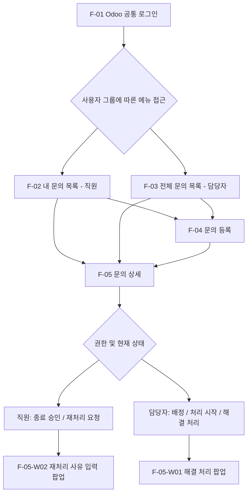

# IT-Helpdesk 화면 설계서 (1차)

> 기준: `docs/requirements.md`, `docs/erd.drawio`  
> 작성 단계: 1일 차 화면 흐름 설계 확정. 실제 Odoo 19 UI 및 접근 제어는 구현·테스트 단계에서 검증.

## 1. 화면 구성과 이동

메뉴 접근 범위는 역할에 따라 다르며, 화면 ID는 화면 설계용 분류다. F-05는 두 역할이 공유하는 Odoo Form View이고 상태와 권한에 따라 버튼을 다르게 표시한다. 실제 로그인 후 자동 진입 경로는 구현에서 검증한다.

## 2. F-01 공통 로그인

- 전체 사용자에게 Odoo 기본 로그인(로그인 ID/비밀번호)을 제공한다.
- 로그인 성공 후 그룹과 접근 권한에 따라 메뉴·접근 가능한 데이터를 구분한다.
- 로그인 실패 및 세션 만료는 Odoo 표준 인증 흐름을 활용한다.
- 임의의 별도 로그인·비밀번호 DB 테이블을 구축하지 않는다.

## 3. F-02 내 문의 목록 — 일반 직원

| 항목 | 확정 내용 |
|---|---|
| 조회 범위 | 로그인한 본인의 문의만; Record Rule로 서버 접근 제한 |
| 컬럼 | 문의 번호, 제목, 유형, 긴급도, 상태, 담당자, 등록일 |
| 검색 | 번호·제목 |
| 필터 | 상태·유형·긴급도 |
| 정렬 | 최신 등록순(기본), 오래된순, 긴급도순 |
| 페이징 | Odoo 기본 페이징 |
| 버튼 | 상단 우측 신규 문의 등록(Odoo 기본 New 버튼 표기는 실제 UI에 맞춤) |
| 이동 | 목록 행 클릭 → F-05, 새 문의 등록 → F-04 |
| 예외 | 본인 문의가 없는 경우 신규 등록 안내, 검색 결과 없는 경우 필터 재설정 가능 |

## 4. F-03 전체 문의 목록 — 담당자

| 항목 | 확정 내용 |
|---|---|
| 조회 범위 | 전체 문의 |
| 컬럼 | F-02의 7개 + 요청자 = 8개 |
| 검색 | 번호·제목·요청자 |
| 필터 | 상태·유형·긴급도·담당자, 미배정 문의, 내 담당 문의 |
| 정렬 | `priority_order DESC, create_date ASC` (긴급→높음→보통→낮음, 같은 긴급도는 오래된 문의 우선); 최신순/오래된순 대체 |
| 메뉴 | 전체 문의, 미배정 문의(동일 목록에 미배정 조건 사전 적용) |
| 버튼 | 새 문의 등록 → F-04 |
| 이동 | 행 클릭 → F-05, 배정/처리/해결은 F-05에서 수행 |
| 페이징·예외 | Odoo 기본 페이징 및 결과 없음 안내 |

## 5. F-04 문의 등록 — 직원·담당자 공통

### 5.1 입력 화면

| 순서 | 항목 | 필수 여부 | 검증 기준 |
|---|---|---|---|
| 1 | 문의 유형 | 필수 | 6개 초기 유형 중 유효값 |
| 2 | 제목 | 필수 | 공백 제외 5~100자 |
| 3 | 내용 | 필수 | 공백 제외 10~5,000자 |
| 4 | 긴급도 | 필수 | 낮음·보통·높음·긴급 |
| 5 | 발생 위치/부서 | 필수 | 공백 제외 2~100자 |
| 6 | 연락처 | 선택 | 입력 시 형식 검사 |
| 7 | 첨부파일 | 선택 | JPG/PNG/PDF/DOCX/XLSX/TXT, 최대 5개·파일당 10MB **설계 목표** |

시스템 자동 필드: 문의 번호 `HD-00001`(순차 생성), 요청자(로그인한 본인), 상태(`received`), 담당자(미배정), 등록일(Odoo 기본 생성 일시).

### 5.2 긴급도 판단 기준

| 단계 | 기준 |
|---|---|
| 낮음 | 업무에 거의 영향 없음 |
| 보통 | 불편하나 대체 방법으로 업무 가능 |
| 높음 | 주요 업무 중단 또는 대체 방법 없음 |
| 긴급 | 다수 직원 업무 중단 또는 핵심 업무 전체의 심각한 장애 |

최초 긴급도는 요청자가 선택하고, 담당자는 현황 확인 뒤 변경할 수 있다. 변경은 History에 기록한다. 등록 화면에 각 단계의 간략한 기준을 안내한다.

### 5.3 저장·취소·검증

- Odoo Form View 기본 저장·취소를 우선 활용한다.
- 저장 성공: 문의 생성 및 번호 발급, 해당 문의 상세를 확인할 수 있도록 한다(정확한 전환은 실제 Odoo 동작 검증).
- 잘못된 입력: 서버에서 저장 차단 및 오류 안내. 인증 실패/세션 만료는 Odoo 표준 흐름을 따른다.
- 첨부는 `mail.thread`/`ir.attachment` 활용. 파일 제한과 서버 ACL 적용 방식은 구현 중 검증한다.
- 담당자가 문의를 등록해도 요청자는 등록한 담당자 본인. 다른 직원을 대신해 등록하는 기능은 1차 범위에서 제외한다.

## 6. F-05 공통 문의 상세

### 6.1 공통 표시 정보

- 식별: 번호, 제목, 현재 상태
- 접수: 요청자, 등록일
- 장애: 유형, 긴급도, 발생 위치, 연락처, 상세 내용
- 처리: 담당자, 해결 방식(`resolution_method`), 해결 결과(`resolution`), 해결/종료 시각
- 협업: 댓글, 첨부파일(Chatter)
- 감사: 상태·담당자·긴급도·재처리·해결 결과 변경 이력(History 별도 조회 영역)

### 6.2 직원의 상태별 작업

| 상태 | 허용 작업 |
|---|---|
| 접수·미배정 | 본인 문의 수정·아카이브, 댓글·첨부, 조회 |
| 배정 / 처리 중 | 본인 문의 댓글·첨부, 상태·이력 조회 |
| 해결 | 해결 결과 확인 후 종료 승인 또는 사유 있는 재처리 요청, 댓글·첨부 |
| 종료 | 조회 전용, 댓글·첨부 추가·수정·아카이브 금지 |

- 종료 승인: 간단한 확인 팝업을 거쳐 `resolved → closed`; `closed_date`와 History 기록.
- F-05-W02 재처리 요청 팝업: 사유 필수, `resolved → in_progress`; `reopen_count` 증가, History에 사유 및 변경자·시각 보존.
- 재처리 시 기존 `resolution`, `resolution_method`, `resolved_date`는 History에 보존하고 Ticket의 현재 세 필드는 초기화한다. 기존 담당자는 유지하고, 다시 해결할 때 신규 해결 결과·방식·시각을 저장한다.

### 6.3 담당자의 상태별 작업

| 상태 | 허용 작업 및 전이 |
|---|---|
| 접수 | 담당자 지정 → 배정 |
| 배정 | 처리 시작 → 처리 중 |
| 처리 중 | F-05-W01 해결 처리 → 해결 |
| 해결 | 요청자 확인 대기; 재배정 시에도 상태 유지. 해결 내용 재작성·종료 전환은 허용된 별도 업무 절차만 가능 |
| 종료 | 일반 수정·상태 변경·댓글·첨부 불가; 담당자(관리자)의 별도 보관·복원 관리 기능만 가능 |

- 담당자 재지정은 상태를 변경하지 않으며 이전·신규 담당자 및 변경자를 이력에 남긴다.
- 긴급도는 담당자가 수정할 수 있고 변경 이력을 남긴다.
- F-05-W01 해결 처리 팝업: **해결 방식** `onsite`(현장 방문) / `remote`(원격·안내) 중 하나와 **해결 결과**를 필수 입력. 검증 통과 시 두 값 저장, `in_progress → resolved`, 해결 시각 및 History 기록을 하나의 작업으로 처리한다.
- 해결 방식은 처리 상태와 별개이다. 별도의 현장 처리/원격 처리 상태는 만들지 않는다.
- 일반 직원의 아카이브는 본인 문의가 `접수`이면서 미배정일 때만 허용한다. 담당자(관리자)는 별도 관리 작업으로 문의 아카이브·복원을 수행할 수 있으며 종료 문의도 대상에 포함된다. 실제 레코드 삭제는 허용하지 않는다.

### 6.4 미응답과 자동 종료

- 1차: 직원이 해결 결과에 응답하지 않으면 `resolved` 유지; 자동 종료 없음.
- 향후 검토: 사전 안내 후 정책상 자동 종료를 검토할 수 있으나, **요청자의 승인으로 기록해서는 안 된다.** 3+2영업일은 확정 정책이 아니라 논의했던 예시이다.

## 7. 공통 접근 권한 및 예외

| 사례 | 기대 동작 |
|---|---|
| 타인의 문의에 직원이 접근 | ACL/Record Rule/관련 첨부 접근에서 거부 |
| 권한 없이 담당자·긴급도·상태 변경 | 서버 차단 |
| 해결 방식 또는 결과 누락 | 해결 불가, 오류 안내 |
| 재처리 사유 누락 | 재처리 불가, 오류 안내 |
| 허용되지 않는 상태 전이 | 서버 차단 |
| 종료된 문의 수정·댓글·첨부 | 서버 차단 |
| 보관된 문의 | 기본 목록 제외; 권한에 맞는 접근만 허용 |
| 없는 문의·동시 변경 | 명확한 오류/재조회 안내, 잘못된 상태 덮어쓰기 방지 |

UI 버튼 숨김만으로 보안을 구현하지 않는다. `ir.model.access`, `ir.rule`과 Python ORM 서버 제약을 함께 사용하고, Chatter·첨부 권한도 테스트한다.

## 8. 구현 전 검증 항목

- Odoo 19의 Form 저장/취소 및 저장 후 진입 위치
- 종료 상태에서 Chatter 댓글/첨부의 서버 차단 가능 여부 및 구현 방식
- 첨부 형식·5개·10MB 제한의 실제 적용 방식
- 해결 결과/해결 방식/해결 시각 기록과 History 정합성, 재처리 후 과거 해결 정보 보존 및 현재 필드 초기화
- 긴급도 값 변경 시 저장형 `priority_order` 자동 갱신 및 F-03 기본 정렬(`priority_order DESC, create_date ASC`) 검증
- 종료된 문의의 일반 수정 차단과 담당자(관리자)의 별도 아카이브·복원 권한 검증
- 직원·담당자 각각의 메뉴/액션/목록·상세 접근 테스트

화면 설계와 실제 구현 사이에 차이가 생기면 `requirements.md`, `erd.drawio`, 본 문서를 함께 갱신한다.
